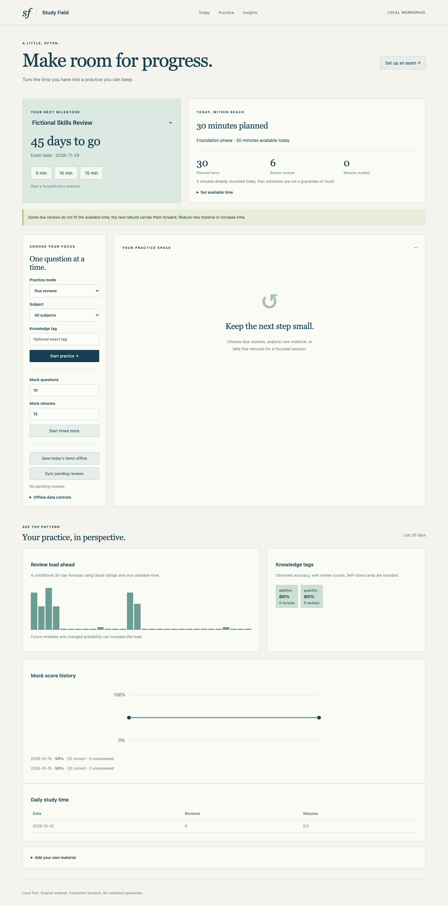

# Spaced Study Planner

**Study Field** is a local exam planner with FSRS reviews, flashcards, original question banks, timed practice, and an offline mobile review queue. It works without accounts, API keys, telemetry, or cloud calls after installation.



## Start in three commands

Python 3.11 or later is required. Run from this repository:

```sh
python3 -m venv .venv && .venv/bin/python -m pip install -e '.[dev]'
SSP_DATA_DIR=data/demo .venv/bin/python examples/seed_demo.py
.venv/bin/ssp --data-dir data/demo serve
```

Open <http://127.0.0.1:8776>. The fictional exam is 45 days after the first seed run. It includes 50 original multiple-choice questions and three flashcards. Repeated seeding reuses the same exam and items. These are teaching fixtures, not past examination questions.

For an empty library, run `ssp --data-dir data/private serve`. On macOS environments that hide editable-install path files, use `chflags nohidden .venv/lib/python3.*/site-packages/*.pth`.

## What it does

- Tracks multiple exams, dates, weighted subjects, and weekly or date-specific study capacity.
- Builds a rolling plan through foundation, reinforcement, sprint, and mock phases. Due reviews take precedence; weighted weaker subjects receive more new work. Each rebuild uses current accepted reviews and remaining time.
- Imports original or authorized JSON/CSV questions, Markdown cards, and basic fields from legacy Anki packages. Supports local images and a MathText subset of LaTeX.
- Offers due, new, mistake, topic, and all-material practice; 5/10/15-minute micro sessions; and timed multiple-choice mocks with subject scores and elapsed time.
- Shows exam countdown, daily study time, a conditional 30-day workload forecast, observed tag accuracy, and a mock-score curve.
- Saves today's items in the browser, queues offline answers, and syncs them with duplicate-request and stale-revision checks.
- Provides a noninteractive CLI, five official-SDK MCP tools, full JSON/CSV interchange, and timestamped backups.

## A daily workflow

```sh
.venv/bin/ssp --data-dir data/demo today --json
.venv/bin/ssp --data-dir data/demo review --mode new --limit 3 --json
.venv/bin/ssp --data-dir data/demo answer quant-01 --answer B --elapsed-s 40 --request-id example-answer-001 --json
.venv/bin/ssp --data-dir data/demo stats --days 30 --json
.venv/bin/ssp --data-dir data/demo forecast --days 30 --json
```

Use an item ID and answer from your review result; `examples/questions.json` documents the demo IDs. Each MCQ answer is graded automatically: correct maps to Good, incorrect maps to Again. For flashcards use `answer ITEM_ID --rating again|hard|good|easy`. Practice APIs include answers and explanations; this is a self-study tool, not a secure assessment service.

```sh
.venv/bin/ssp --data-dir data/demo availability --key weekday:0 --minutes 30
.venv/bin/ssp --data-dir data/demo availability --key 2026-11-01 --minutes 5
.venv/bin/ssp --data-dir data/demo plan --rebuild --json
.venv/bin/ssp --data-dir data/demo mock --n 50 --minutes 60 --json
```

Replace the example date with your travel day. Weekday 0 is Monday. Date overrides take precedence; unspecified days have 30 minutes. Starting a mock returns a session ID and item list. Submit answers with `--session SESSION_ID`, then `finish SESSION_ID`. Unanswered questions count as incorrect; elapsed time is summed from accepted answers. Session deadlines reject late answers. CLI `--at` supports offset-aware replay, so timing is not tamper-resistant.

## Scheduling and forecast boundaries

The FSRS adapter uses the [official Python implementation](https://github.com/open-spaced-repetition/py-fsrs), default parameters, configurable desired retention, disabled fuzzing, and no learning/relearning steps. Fixed-sequence tests compare complete states and due times with that implementation at retention 0.8, 0.9, and 0.95. There is no personal parameter fitting or automatic claim of exam readiness.

The alternative is a documented [SM-2](https://www.super-memory.com/english/ol/sm2.htm) variant: Again/Hard/Good/Easy map to qualities 1/3/4/5; successful initial intervals are 1 and 6 days, then the ceiling of the previous interval times the previous ease. Ease follows the published update with a floor of 1.3; a failed recall resets repetition count and gives a one-day interval. This version omits intraday repetition drills.

Each imported item retains its algorithm. Changing configuration affects new items; retention affects subsequent FSRS reviews. Plans simulate Good ratings once per item per calendar day and use entered estimated durations. They never overbook available seconds, but cannot guarantee complete coverage or mastery. Unfitted work produces warnings and suggestions to reduce new material or add time. `today` uses a one-day horizon; `forecast` uses the requested horizon, capped at the exam date. No work is scheduled on or after exam day.

Phase boundaries are 35%, 65%, and 85% of the interval from the first plan to exam day. They remain stable across rebuilds. Phases label the plan; they do not generate a syllabus or a full mock automatically. Observed accuracy includes self-rated cards and is not calibrated retention.

## Configuration and data

```yaml
# examples/config.yaml
data_dir: ../data/private
timezone: Asia/Shanghai
algorithm: fsrs
retention: 0.9
```

Run `ssp --config examples/config.yaml today --json`. Data path precedence is `--data-dir`, `SSP_DATA_DIR`, config `data_dir`, then `./data`. `--config` overrides `SSP_CONFIG`. Relative config data paths resolve beside the config file. Valid retention is at least 0.1 and below 1. Timestamps require explicit UTC offsets; calendar planning uses the configured IANA timezone.

SQLite (`study.db`) holds exams, subjects, items, states, reviews, sessions, plans, availability, and metadata. `assets/` holds normalized local image copies. Keep configuration with your backups; ordinary JSON/CSV exports contain records and assets, not configuration.

```sh
.venv/bin/ssp --data-dir data/demo export --format json --out data/library.json
.venv/bin/ssp --data-dir data/demo export --format csv --out data/library.csv
.venv/bin/ssp --data-dir data/restored import data/library.json --library
.venv/bin/ssp --data-dir data/demo backup
```

CSV archives use UTF-8 BOM and `record_type,data` rows. They preserve complete state and image bytes and differ from flat item-import CSV. Identical records skip on repeat import; conflicting IDs roll back the database batch. Export replacement requires `--yes`. Library imports require complete internally consistent version-1 snapshots; payloads, states, references, review histories, and schedules are validated before commit. Partial handcrafted histories are rejected. A backup ZIP contains a SQLite snapshot, assets, and effective settings. Stop writers, extract into a fresh data directory, and configure those settings to restore. Cross-file operations are not crash-atomic; keep the original backup.

### Item format

```json
[{"id":"my-card","type":"card","subject":"Reasoning","front":"What is 2 + 2?","back":"4","tags":["arithmetic"],"seconds":30},
 {"id":"my-question","type":"mcq","subject":"Quantitative","front":"Choose the even number.","options":["3","4"],"answer":"B","explanation":"4 is divisible by 2.","tags":["parity"],"difficulty":1,"seconds":60,"source":"My original exercise"}]
```

Create subjects first. Import with `ssp import FILE --subject SUBJECT` or supply a subject per row. CSV `options` and `tags` cells contain JSON arrays. Markdown cards use `???` between front and back and a line containing `---` between cards. Local image paths must remain within the import directory and are copied; remote images are rejected, including reference-style Markdown images. Import local images using inline Markdown syntax. Inline `$x^2$` and display `$$x^2$$` use offline MathText image rendering, not a full TeX engine. Raw HTML is escaped.

Legacy `.apkg` supports `collection.anki2` or `collection.anki21`, the first two fields, tags, and referenced image media. Import produces basic cards with new local schedules. Cloze semantics, custom templates, audio/video, and Anki review history are not preserved. Modern `collection.anki21b` compression is explicitly rejected. Export legacy packages from Anki if needed.

## Offline browser practice

Select **Save today's items offline** while the server is running, then use that same browser and origin. The service worker caches the shell and local media; item content and pending reviews remain in browser storage. Scheduling is calculated on the server after sync. Offline micro sessions use saved material; starting a timed mock requires the server. Cached results can be stale.

Use **Sync pending reviews** when the local server returns. A conflict stops sync and preserves the queue. Review the conflict before explicitly discarding any pending answers. Clearing the cache is blocked while answers remain pending. Do not clear browser data before syncing. This release uses browser local storage and is intended for one active review tab per device; simultaneous offline tabs are unsupported. Data is unencrypted on the device. Serving is loopback-only; direct phone access over a LAN and cross-device cloud sync are outside this release.

## Verification and limits

```sh
.venv/bin/ruff check .
.venv/bin/ruff format --check .
.venv/bin/pytest --cov=spaced_study_planner --cov-report=term-missing
```

See [docs/VALIDATION.md](docs/VALIDATION.md) for measured results, [AGENTS.md](AGENTS.md) for complete command and MCP instructions, and [CHANGELOG.md](CHANGELOG.md) for this release. CI checks Ubuntu Python 3.11 and 3.12. The UI contains no build step or external asset requests.

The built-in planner is a capacity heuristic. Item durations and subject weights are user estimates. It supports exams up to 3,660 days away and practice response batches up to 500 items (exact offline plans and session selection inspect the full library). Large imports and long horizons can be expensive; this release targets modest personal libraries. There is no online question downloader, copyrighted exam bank, notification daemon, automatic daily push, hosted service, optimized FSRS parameter training, or medical/educational diagnosis. MIT licensed.
